

  

<h1 align="center">MAIE</h1>

  <strong>Fertility treatment companion for patients, partners, and care teams.</strong> 
  Plan the cycle. Keep up with medication. Arrive prepared. Feel less alone.

  
  
  
  
  
  
  

  <a href="https://github.com/RobertoDure/maie">Repository</a> ·
  <a href="https://github.com/RobertoDure/maie/issues">Issues</a> ·
  <a href="#getting-started">Get started</a> ·
  <a href="#roadmap">Roadmap</a>

> [!IMPORTANT]
> **MVP / pre-release.** The core patient flows are implemented, but production hardening is still required — especially database RLS, secure session storage, automated tests, and a formal privacy/regulatory review.
>
> MAIE is **not a medical device** and is **not a substitute for advice, diagnosis, or treatment from a qualified clinician**. Always follow your clinic's instructions.

---

## Table of contents

- [Why MAIE](#why-maie)
- [The problem](#the-problem)
- [The solution](#the-solution)
- [Who it is for](#who-it-is-for)
- [Business context](#business-context)
  - [Market context](#market-context)
  - [Target market](#target-market)
  - [Value proposition](#value-proposition)
  - [Competitive landscape](#competitive-landscape)
  - [Business model hypotheses](#business-model-hypotheses)
  - [Go-to-market](#go-to-market)
  - [Success metrics](#success-metrics)
  - [Risks and mitigations](#risks-and-mitigations)
- [Business requirements and status](#business-requirements-and-status)
- [Features](#features)
- [Product tour](#product-tour)
- [Screenshots](#screenshots)
  - [Home and cycle management](#home-and-cycle-management)
  - [Appointments](#appointments)
  - [Medications](#medications)
  - [Community and chat](#community-and-chat)
  - [Wellness](#wellness)
  - [Profile and settings](#profile-and-settings)
- [Architecture](#architecture)
- [Technology stack](#technology-stack)
- [Engineering rationale](#engineering-rationale)
- [Data model](#data-model)
- [Getting started](#getting-started)
- [Supabase setup](#supabase-setup)
- [Environment variables](#environment-variables)
- [Scripts](#scripts)
- [Quality and testing](#quality-and-testing)
- [Security, privacy and compliance](#security-privacy-and-compliance)
- [Design system](#design-system)
- [Deployment](#deployment)
- [Roadmap](#roadmap)
- [Known limitations](#known-limitations)
- [Contributing](#contributing)
- [License](#license)
- [Support](#support)
- [FAQ](#faq)
- [Acknowledgements](#acknowledgements)
- [Medical disclaimer](#medical-disclaimer)

---

## Why MAIE

Fertility treatment is a high-stakes, time-sensitive, and emotionally demanding journey. A single IVF, IUI, FET, or timed cycle can involve dozens of medication doses, multiple monitoring appointments, changing protocols, lab results, and a lot of waiting — often coordinated across clinic portals, paper schedules, messaging apps, and spreadsheets.

MAIE brings the patient's day-to-day treatment life into one calm, mobile-first workspace:

- **A cycle timeline** that reflects the treatment, not just a period prediction.
- **Medication schedules and dose confirmations** that are easy to follow.
- **Appointments and reminders** in one calendar.
- **Mood and symptom check-ins** to help patients notice patterns and prepare for conversations with their care team.
- **Partner sharing** so a caregiver is not left in the dark.
- **A peer community and private messaging** so patients feel less alone.

The product is intentionally **patient-first and clinician-adjacent**: it supports the work a clinic asks the patient to do, while making clear that it does not replace clinical judgment.

### At a glance

| | |
|---|---|
| **Product** | MAIE — a fertility treatment companion |
| **Category** | Digital fertility / women's health / care coordination |
| **Primary users** | Patients undergoing IVF, IUI, FET, or timed cycles |
| **Secondary users** | Partners and caregivers; clinicians and clinics (future) |
| **Platforms** | iOS, Android, Web (Expo / React Native) |
| **Frontend** | Expo SDK 58, React 19, React Native 0.88, TypeScript 6 |
| **Backend** | Supabase: Postgres, Auth, Storage, Realtime |
| **Status** | MVP, version 1.0.0, not yet published to stores |
| **Repository** | [github.com/RobertoDure/maie](https://github.com/RobertoDure/maie) |

---

## The problem

1. **Treatment is operationally complex.** Patients manage medication names, doses, routes, times, injection instructions, scans, blood work, and transfer dates — often under physical and emotional stress.
2. **Information is fragmented.** Clinic portals are authoritative but not designed as a daily companion. Instructions arrive through PDFs, phone calls, emails, and messages. Patients build their own spreadsheets to cope.
3. **Adherence is hard.** Missed or late doses can matter. Reminders are generic, and logging a dose is often separate from the schedule.
4. **Partners are excluded.** A partner often wants to help but has no reliable view of the schedule or appointments.
5. **Emotional support is disconnected from care.** Peer communities exist on social platforms, but they are public, noisy, and not connected to the patient's private treatment context.
6. **Existing trackers optimize the wrong thing.** Period and ovulation apps are excellent for prediction; medically assisted cycles need protocol-aware tracking, appointment coordination, and adherence support.

## The solution

MAIE is a single treatment companion with a deliberately narrow scope:

- **Cycle-centric:** the treatment cycle is the organizing object, not a generic menstrual calendar.
- **Action-oriented:** medications, appointments, and daily check-ins are first-class features.
- **Partner-inclusive:** patients can share a cycle with read or write access.
- **Community-aware:** peer support is available without mixing it into the private clinical record.
- **Cross-platform:** one TypeScript codebase for iOS, Android, and web preview.
- **Built on a relational foundation:** cycles, medications, appointments, sharing, and messaging are naturally relational and benefit from SQL and row-level access control.

## Who it is for

| Persona | Needs | How MAIE helps today |
|---|---|---|
| **Patient** (primary) | Clarity, adherence, emotional tracking, less admin | Cycle setup, medication schedule, appointments, mood/symptom logs, community |
| **Partner / caregiver** | Visibility and a way to help | Shared cycle access (read or write) |
| **Clinician** (future) | Adherence and symptom context between visits | RBAC role exists; clinician portal not built yet |
| **Fertility clinic** (B2B, future) | Better patient experience and adherence | Clinic-facing dashboard is on the roadmap |
| **Community member** | Peer support in a safer, topic-specific space | Feed, reactions, comments, direct and group chat |

---

## Business context

### Market context

Fertility care sits at the intersection of **clinical complexity, high out-of-pocket cost, and intense emotional load**. Patients frequently describe treatment as a second job: appointments, injections, blood draws, insurance calls, and uncertainty. The market already contains strong period trackers, fertility-specific trackers, clinic portals, and social communities — but the experience is fragmented.

MAIE's thesis is that a **treatment-cycle-native companion** can own the daily workflow that generic trackers and clinic portals do not: medication adherence, appointment preparation, emotional check-ins, partner inclusion, and peer support in one place.

> Market sizing and pricing are intentionally not asserted in this README. Validate both with primary research and clinic design partners before making external claims.

### Target market

- **Primary (B2C):** people actively undergoing assisted reproduction — IVF, IUI, FET, and timed cycles — initially in English-speaking markets.
- **Secondary (B2C):** partners and caregivers who need visibility and a lightweight way to help.
- **B2B2C:** fertility clinics, reproductive endocrinology practices, and fertility benefits providers.
- **Geography:** the UI is English-only today, but the profile supports multiple timezones and the architecture is location-agnostic. Localization is a roadmap item.

### Value proposition

**For patients**
- Less cognitive load: one place for cycles, medications, appointments, and check-ins.
- Better adherence: schedules, daily confirmations, and local reminders.
- More prepared visits: mood and symptom history is recorded over time.
- Less isolation: a peer community and private chat.

**For partners**
- Shared visibility into the treatment cycle.
- Optional write access to help with medication confirmations.

**For clinics (future)**
- Better patient engagement between visits.
- A structured view of adherence and self-reported symptoms.
- A differentiated patient experience without replacing the clinic's EMR.

### Competitive landscape

| Category | Typical strength | Gap MAIE targets |
|---|---|---|
| Period / ovulation trackers | Broad adoption, prediction, habit | Not protocol-aware; weak medication and appointment workflows |
| Fertility-specific trackers | Cycle insight and education | Often limited partner collaboration and clinic-adjacent workflows |
| Clinic patient portals | Authoritative clinical data | Fragmented UX, poor daily engagement, little peer support |
| Social communities | Emotional support and lived experience | Privacy concerns, noise, misinformation, no treatment context |
| General messaging apps | Familiar and fast | No structure, no reminders, no cycle context |

**MAIE's wedge:** structured treatment tracking + partner sharing + peer support in one patient-owned experience.

### Business model hypotheses

These are candidate models, not commitments. No payments or subscriptions are implemented today.

| Model | Buyer | What is sold | Readiness |
|---|---|---|---|
| **Freemium B2C** | Patient | Premium insights, partner seats, export, advanced reminders | Hypothesis |
| **Clinic SaaS** | Fertility clinic | Patient engagement, adherence visibility, branded experience | Requires clinician dashboard |
| **Fertility benefits / employer** | Employer or benefits manager | Fertility support program and engagement | Requires outcomes evidence |
| **White-label** | Clinic or fertility brand | Branded patient companion | Later stage |
| **Care-adjacent partnerships** | Pharmacy / telehealth / diagnostics | Referrals or integrated services | Only with compliance review |

**Guardrail:** do not monetize patient health data. Any data partnership must be de-identified, consented, and legally reviewed.

### Go-to-market

1. **Clinic design partners (0–6 months).** Recruit 3–5 fertility clinics and 20–50 patients. Instrument adherence, appointment preparation, and patient-reported experience.
2. **Clinic pilot (6–12 months).** Measure dose confirmation, appointment attendance, patient NPS, and partner engagement. Publish only validated, non-clinical claims.
3. **Community-led D2C (12–18 months).** Partner with patient advocates, infertility creators, and moderated communities. Keep medical claims out of acquisition.
4. **Benefits and employer channel (18+ months).** Requires evidence, security review, and a scalable support model.

### Success metrics

| Metric | Definition | Why it matters |
|---|---|---|
| **Activation** | % of new users who create a cycle and add a medication within 24 hours | Measures time-to-value |
| **Dose adherence** | Confirmed doses ÷ scheduled doses | Core clinical-adjacent value |
| **Appointment preparedness** | % of appointments viewed or opened before the visit | Reduces missed visits and anxiety |
| **Weekly check-in rate** | % of active users logging mood/symptom at least once a week | Engagement and emotional value |
| **D7 / D30 retention** | Active users returning after 7 / 30 days | Product-market fit signal |
| **Partner share rate** | % of cycles shared with a partner | Caregiver inclusion |
| **Community health** | Posts, comments, and conversations per active user; report rate | Engagement and safety |
| **Trust** | Support contacts, data-rights requests, privacy questions | Brand and compliance health |

### Risks and mitigations

| Risk | Why it matters | Mitigation |
|---|---|---|
| **Clinical / regulatory** | Fertility is high-stakes; diagnostic or treatment claims may trigger medical-device regulation | No diagnosis or treatment recommendations; clinical advisory review; disclaimers; formal regulatory assessment before adding decision support |
| **Privacy / security** | Health data is sensitive; a breach is existential | RLS on every table, least privilege, secure session storage, encryption, audit logging, pen testing |
| **Community safety** | Peer support can spread misinformation or expose identities | Guidelines, reporting, moderation, crisis resources, no public sharing by default |
| **Data accuracy** | Users enter medication and appointment data manually | Confirmation UI, editable data, audit trail, clear "verify with your clinic" messaging |
| **Adoption** | Patients are overwhelmed; another app can feel like another task | Calm UX, fast onboarding, partner value, clinic endorsement |
| **Platform dependency** | Supabase and Expo are single points of dependency | Abstract services, versioned migrations, export strategy, vendor review |

---

## Business requirements and status

| Requirement | Business outcome | Current status |
|---|---|---|
| Secure account creation, sign-in, and role-aware session | Trust and access control | **Implemented** |
| Create and manage a treatment cycle | Activation and core value | **Implemented** |
| Display cycle phases | Treatment literacy | **Partial** — read-only display; no phase editor |
| Schedule and confirm medications | Adherence | **Implemented** — single dosage per medication in the UI |
| Manage appointments | Reduce missed visits | **Implemented** |
| Log mood and symptoms | Emotional insight and retention | **Implemented** |
| Share a cycle with a partner | Caregiver inclusion | **Partial** — read/write UI; expiry supported in service but not exposed |
| Peer community feed | Engagement and support | **Implemented** — no moderation tooling yet |
| Direct and group messaging | Private support | **Partial** — invite inbox/acceptance UI missing |
| Medication reminders | Adherence | **Partial** — local reminders only; preference screen not wired |
| Privacy controls and data rights | Compliance and trust | **Partial** — UI placeholders; export/delete not implemented |
| Clinician / clinic dashboard | B2B revenue | **Not started** |
| Outcome analytics and reporting | Evidence and sales | **Not started** |
| Automated tests and CI | Release confidence | **Not started** |

---

## Features

### Patient core

- **Authentication and onboarding**
  - Email/password sign-up and sign-in via Supabase Auth.
  - Profile row and default patient role created at sign-up.
  - Session restored on launch and refreshed automatically.
- **Cycle management**
  - Cycle types: IVF, IUI, FET, Timed.
  - Statuses: planned, active, completed, cancelled.
  - Clinic name, protocol name, start date, optional end date.
  - Edit and delete; deletion cascades through related records in the service layer.
  - Active-cycle summary on the home dashboard.
- **Appointments**
  - Create, edit, and delete appointments.
  - Types: ultrasound, blood work, retrieval, transfer, follow-up, consultation, other.
  - Date/time, location, clinician, and notes.
  - Month calendar with marked appointment dates; day-level list.
- **Medications**
  - Add, edit, view, and delete medications.
  - Routes: injection, oral, vaginal, patch, other.
  - Units: mg, iu, mcg, ml, tablet.
  - Daily dosage time, purpose, and instructions.
  - Confirm a dose as taken; today's confirmed doses are reflected in the card.
  - Local reminder scheduling (see Notifications).
- **Mood and wellness**
  - Daily mood score (1–5) and anxiety score (1–5).
  - Optional notes.
  - Symptom logging with 10 common symptoms and severity (1–5).
  - 14-day trend data with a 7-day bar view (mood and anxiety).
  - Prevents a second mood check-in on the same day at the UI level.
- **Profile and account**
  - Avatar upload from camera or library, stored in Supabase Storage.
  - Edit full name, date of birth, and timezone.
  - Read-only account status and member-since fields.
  - Sign out.

### Sharing and access

- **Cycle sharing**
  - Patient can share a cycle with another user.
  - Access levels: read and write.
  - Optional expiry is supported by CycleService.shareAccess.
  - RBACService checks patient ownership and shared access before reads/writes.
  - Role model: patient, partner, clinician, admin.
- **Audit logging**
  - Best-effort audit_logs entries for create, read, update, delete, share, list, and dose confirmation events.
  - Intended for traceability, not tamper-proof compliance logging.

### Community and messaging

- **Community feed**
  - Text posts and optional images.
  - Image upload to the post-images storage bucket.
  - Reactions: like, heart, hug, strength.
  - Comments on posts.
  - Delete own posts and comments.
  - Pinned and milestone post presentation.
  - Realtime refresh when new posts arrive.
- **Chat**
  - Direct conversations and group conversations.
  - Participant roles (admin / member).
  - Text messages, soft delete, reply preview, and read-receipt persistence (no read-status UI yet).
  - Realtime message subscription and typing indicators.
  - Conversation invitations (service and invite screen; acceptance inbox is missing).
  - Unread counts and last-message previews in the chat list.

### Notifications

- Local medication reminders scheduled for a rolling 7-day window.
- Reminder fires 30 minutes before each dosage time.
- Android channel: medication-reminders with high importance and vibration.
- Notification tap deep-links to the medications tab.
- Expo Go skips notification setup because remote push APIs are unavailable on SDK 53+; use a development build for the full experience.

### Platform and UX

- Expo Router file-based navigation with typed routes.
- React Compiler enabled in app.json.
- Purple/mint brand system, reusable cards, consistent spacing and shadows.
- Haptics for tab presses, dose confirmation, and mood actions.
- Bottom sheet for avatar selection.
- Safe-area aware screens.
- Light and dark theme tokens exist; the UI is primarily designed and tested in light mode.

---

## Product tour

Route-level map of the app. For captured screens and UI details, see [Screenshots](#screenshots).

| Route | Screen | Purpose | Status |
|---|---|---|---|
| /(auth)/sign-in | Sign in | Email/password login | Implemented |
| /(auth)/sign-up | Sign up | Account creation with name, email, password | Implemented |
| /(tabs)/explore | Home | Greeting, calendar, daily appointments, quick actions, active cycle, tip | Implemented |
| /(tabs)/index | Cycles | List cycles and start a new one | Implemented |
| /(tabs)/medications | Medications | Cycle selector, medication list, dose confirmation, CRUD | Implemented |
| /(tabs)/community | Community | Feed/chats segmented view, post composer, conversations | Implemented |
| /(tabs)/mood | Wellness | Daily check-in, symptom logger, trends | Implemented |
| /(tabs)/profile | Profile | Avatar, account menu, sign out | Implemented |
| /cycle/new | New cycle | Create a treatment cycle | Implemented |
| /cycle/[id] | Cycle detail | Overview, phases, quick actions | Implemented |
| /cycle/[id]/edit | Edit cycle | Update or delete a cycle | Implemented |
| /cycle/[id]/appointments | Appointments | Appointment CRUD and schedule | Implemented |
| /cycle/[id]/share | Share cycle | Grant read/write access to a partner | Implemented |
| /appointments/[date] | Appointments by date | Day-level appointment list | Implemented |
| /community/post/[id] | Post detail | Post and comment thread | Implemented |
| /community/chat/new | New chat | User search, direct chat, group creation | Implemented |
| /community/chat/[id] | Chat | Messages, compose, realtime, typing, read-receipt persistence | Implemented |
| /community/chat/invite | Invite to chat | Search and invite users | Implemented |
| /profile/personal-info | Personal info | Edit profile and avatar | Implemented |
| /profile/notifications | Notification preferences | Local UI toggles | UI only |
| /profile/privacy-security | Privacy and security | Local UI toggles and legal links | UI only |
| /modal | Modal | Expo starter placeholder | Template leftover |

## Screenshots

  <em>iOS screenshots (1206 × 2622) captured with the demo dataset. Names, clinics, clinicians, and appointments are sample data.</em>

All images live in [docs/screens/](docs/screens/). Click any screenshot to open the full-resolution file. The gallery follows the core patient journey: plan the cycle, manage appointments and medication, check in with yourself, and connect with the community.

### Home and cycle management

| | |
|---|---|
| <a href="docs/screens/home-dashboard.png">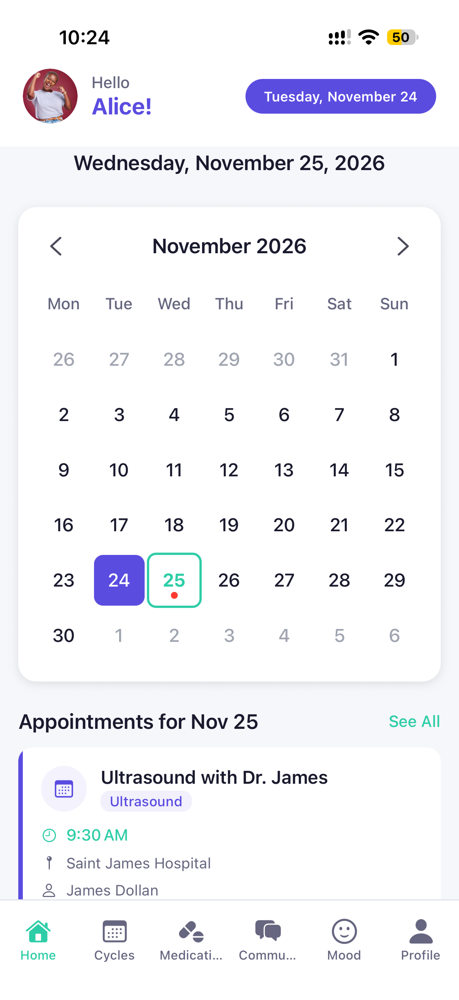</a> **Home dashboard** — greeting and current date, month calendar with appointment markers, the selected day's appointment, mood and medication quick actions, active cycle summary, and a daily tip. | <a href="docs/screens/my-cycles.png">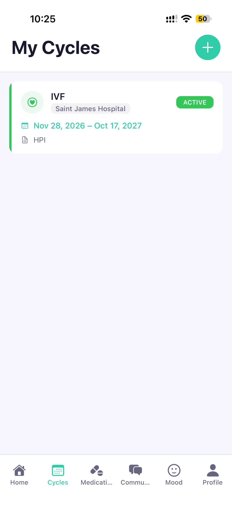</a> **My Cycles** — cycle cards show treatment type, clinic, date range, protocol, and status. The plus button opens the cycle creation flow. |
| <a href="docs/screens/cycle-detail.png">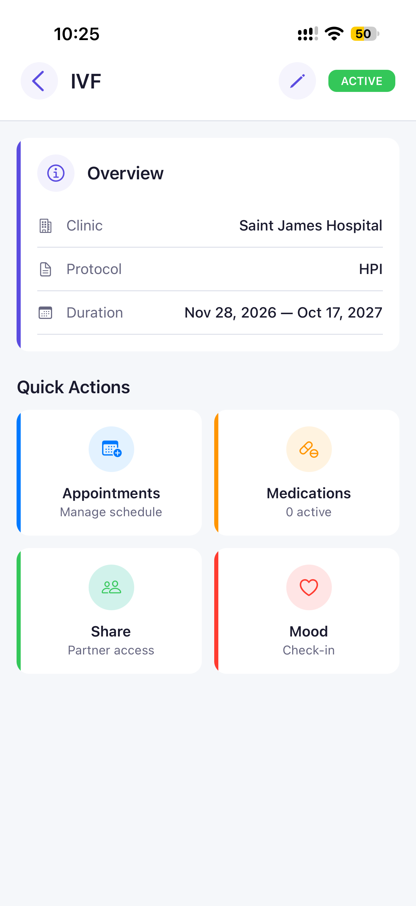</a> **Cycle detail** — overview of clinic, protocol, and duration, with quick actions for appointments, medications, partner sharing, and mood. The phase timeline appears here when phases are configured. | <a href="docs/screens/edit-cycle.png">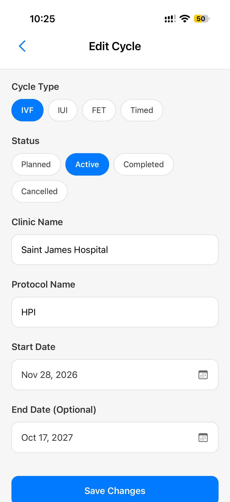</a> **Edit cycle** — chip selectors for cycle type and status, clinic and protocol fields, start/end dates, save action, and the destructive delete action. |

### Appointments

| | | |
|---|---|---|
| <a href="docs/screens/appointment-list.png">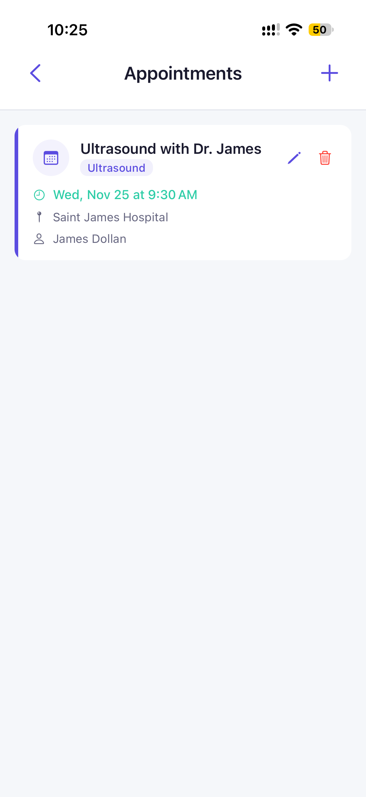</a> **Appointment list** — appointment cards with a type badge, date/time, clinic, clinician, and edit/delete actions. The plus button creates a new appointment. | <a href="docs/screens/edit-appointment.png">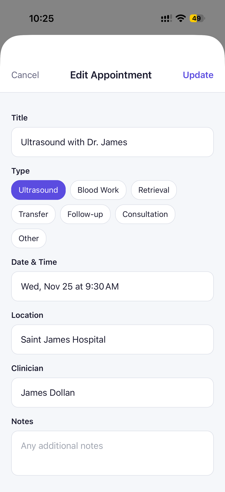</a> **Edit appointment** — modal form with title, appointment type chips, date/time, location, clinician, and notes. | <a href="docs/screens/new-appointment.png">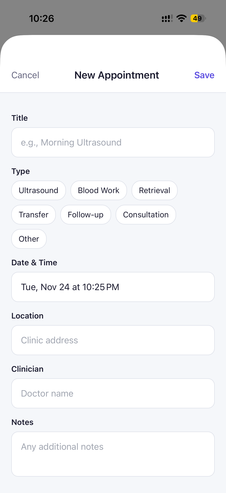</a> **New appointment** — the same form in create mode, prefilled with the current date/time and blank optional fields. |

### Medications

| | |
|---|---|
| <a href="docs/screens/medication-list.png">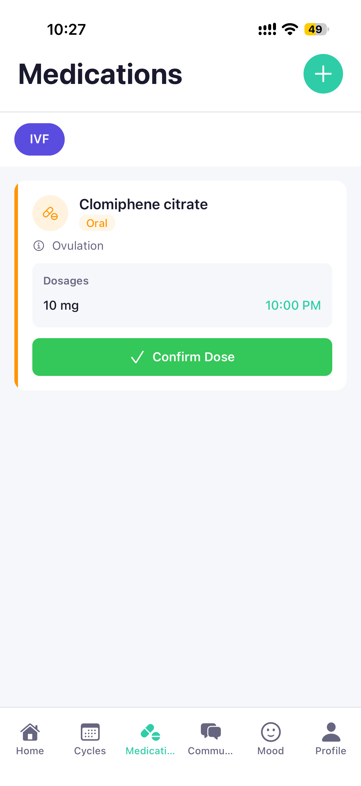</a> **Medication list** — cycle selector, route icon, purpose, dosage amount/time, and a Confirm Dose action for the next scheduled dose. | <a href="docs/screens/medication-taken-today.png">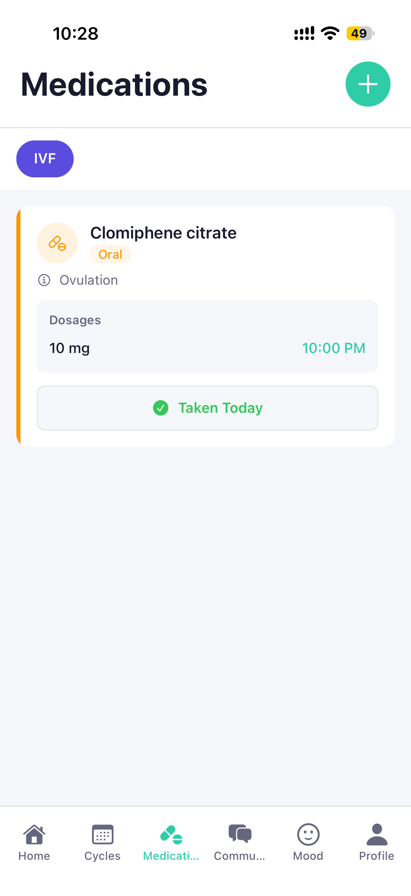</a> **Dose confirmed** — the same medication card switches to a green Taken Today state after the dose is confirmed. |
| <a href="docs/screens/add-medication.png">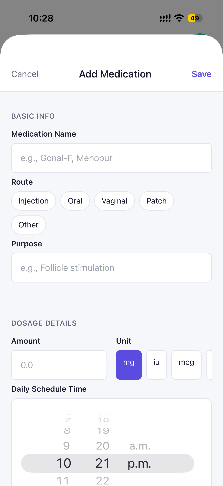</a> **Add medication** — basic info (name, route, purpose) plus dosage amount, unit, daily schedule time, and instructions. | <a href="docs/screens/medication-details.png">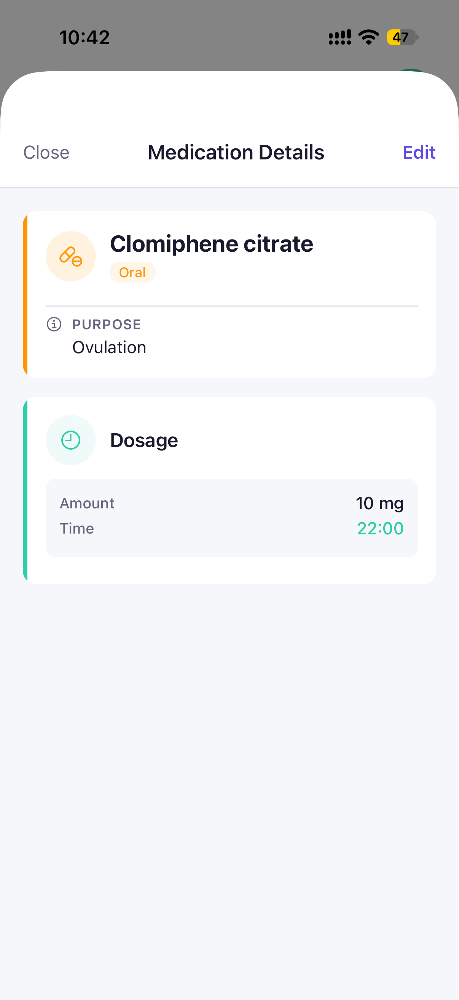</a> **Medication details** — read-only view of the medication's purpose and dosage schedule, with an Edit action. |

### Community and chat

| | |
|---|---|
| <a href="docs/screens/community-feed.png">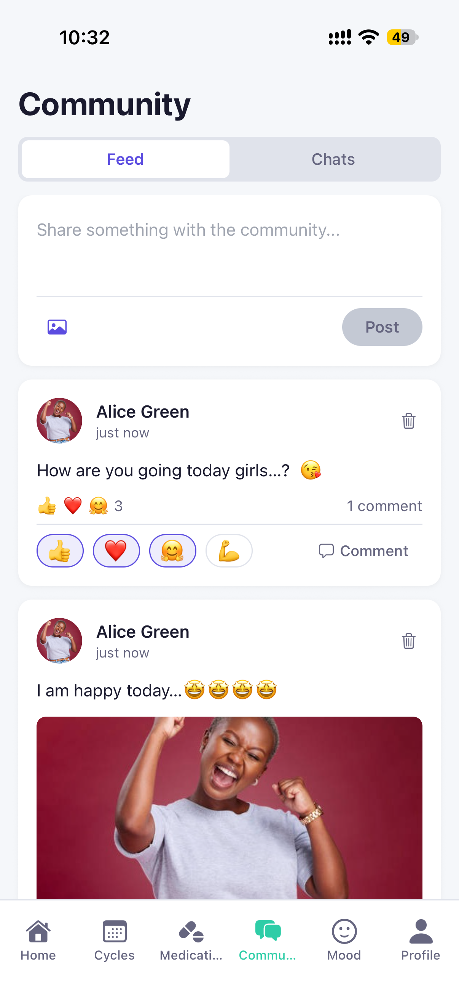</a> **Community feed** — Feed/Chats segments, a post composer with image attachment, posts with reactions and comments, and delete controls for the author's own content. | <a href="docs/screens/post-detail.png">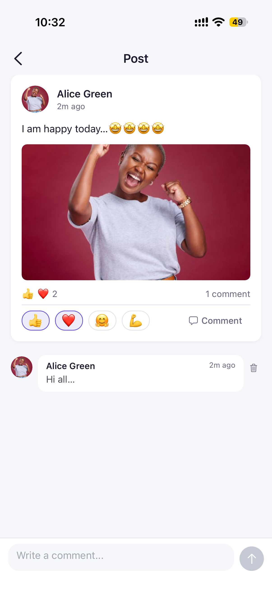</a> **Post detail** — full post, image, reaction summary, comment thread, and a fixed comment composer. |
| <a href="docs/screens/chat-list.png">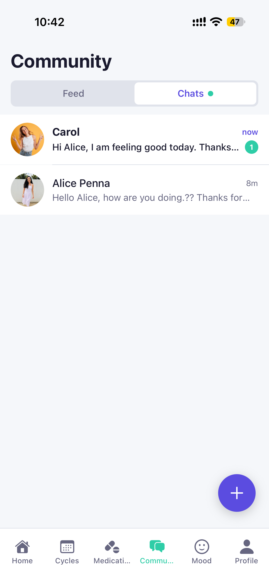</a> **Chats list** — direct and group conversations with the other participant's avatar, last message, relative time, and unread badge. The floating action starts a new chat. | <a href="docs/screens/direct-chat.png">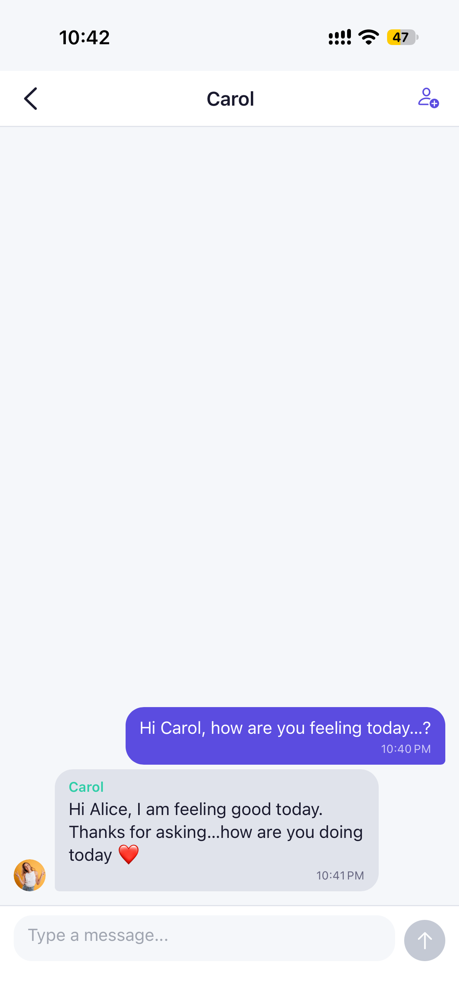</a> **Direct chat** — sender bubbles, timestamps, message composer, and the invite participant action in the header. Messages are delivered through Supabase Realtime. |

### Wellness

| | |
|---|---|
| <a href="docs/screens/wellness-check-in.png">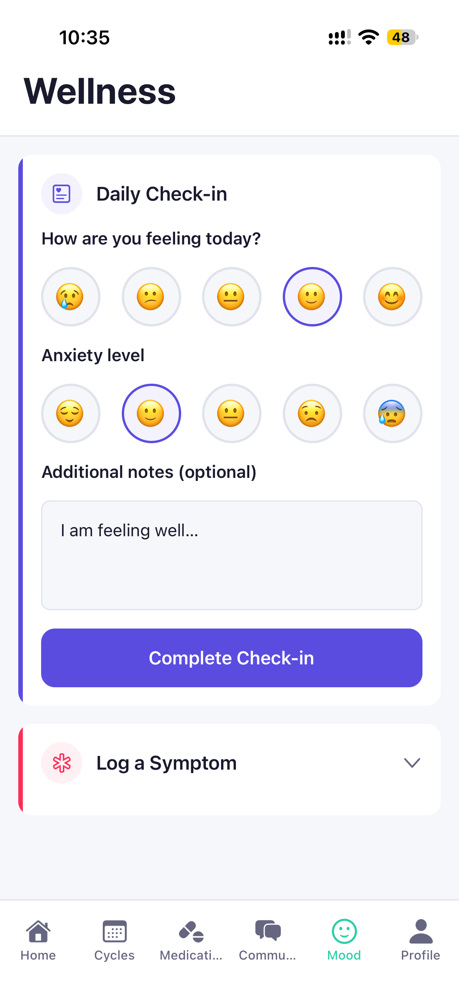</a> **Daily check-in** — mood and anxiety selectors (1–5), optional notes, and the Complete Check-in action. The symptom logger is collapsed below. | <a href="docs/screens/wellness-symptom-log.png">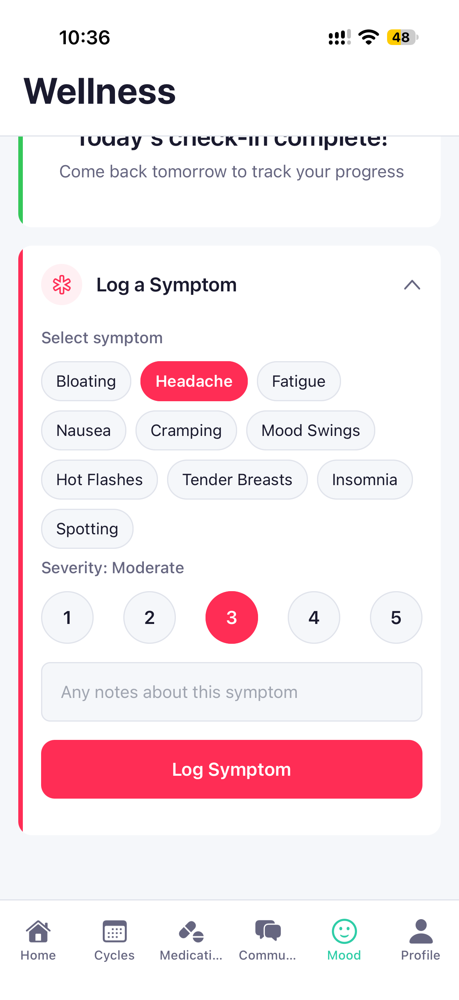</a> **Completed check-in and symptom logging** — the check-in card confirms completion, while the expanded symptom logger shows 10 symptom chips, severity 1–5, notes, and the Log Symptom action. |

### Profile and settings

| | |
|---|---|
| <a href="docs/screens/profile.png">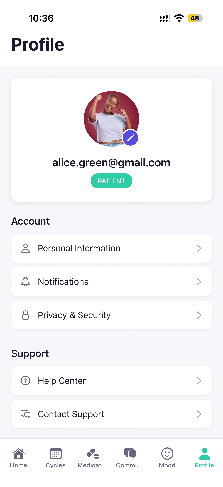</a> **Profile** — avatar, email, role badge, account links (personal information, notifications, privacy and security), and support entry points. | <a href="docs/screens/personal-information.png">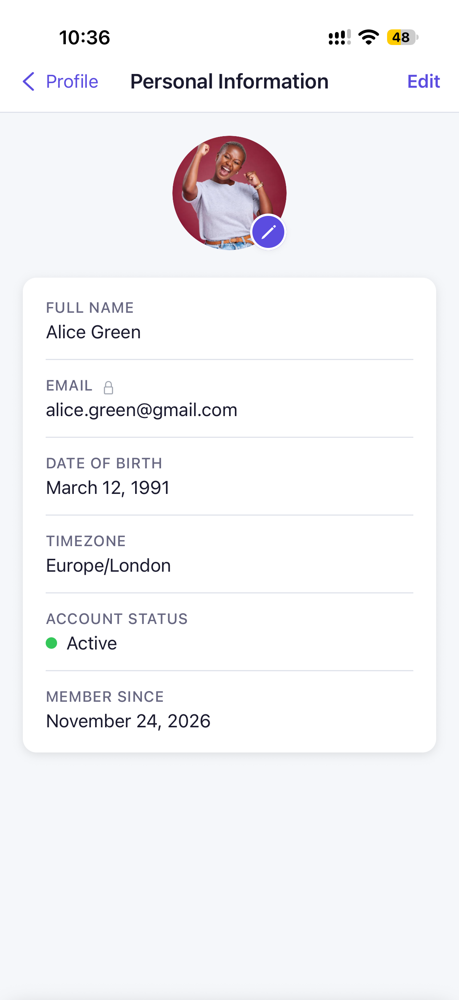</a> **Personal information (view)** — read-only full name, email, date of birth, timezone, account status, and member-since date. |
| <a href="docs/screens/edit-personal-information.png">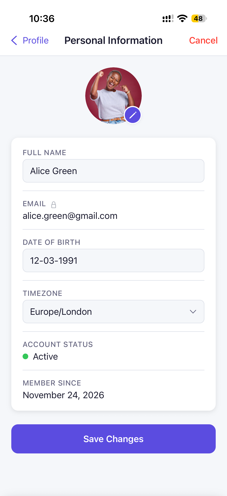</a> **Personal information (edit)** — editable full name, masked date of birth, timezone picker, and save/cancel controls. | <a href="docs/screens/notification-preferences.png">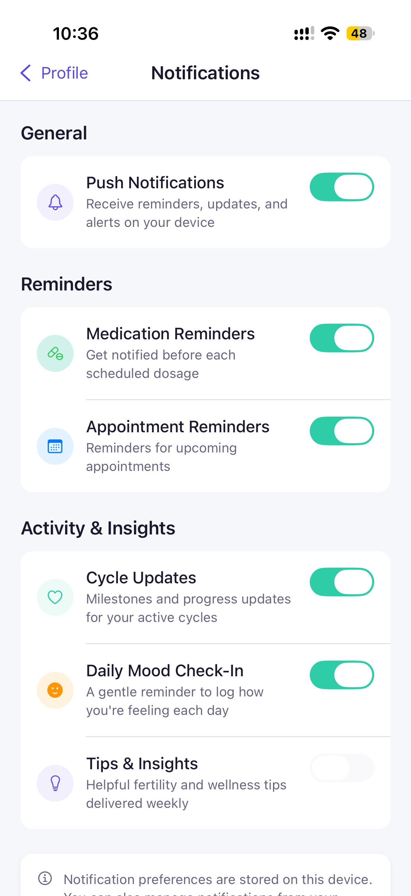</a> **Notification preferences** — per-category toggles for push, medication, appointment, cycle, mood, and tips. Persistence is currently UI-only. |
| <a href="docs/screens/privacy-and-security.png">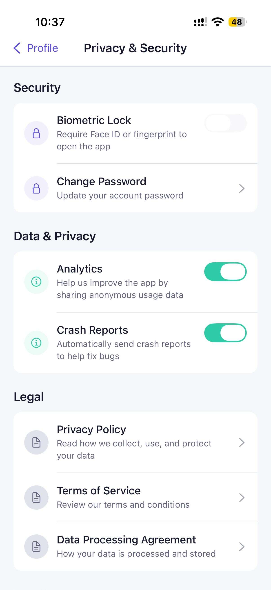</a> **Privacy and security (top)** — biometric lock, change password, analytics, crash reports, and legal document links. | <a href="docs/screens/privacy-and-security-data-rights.png">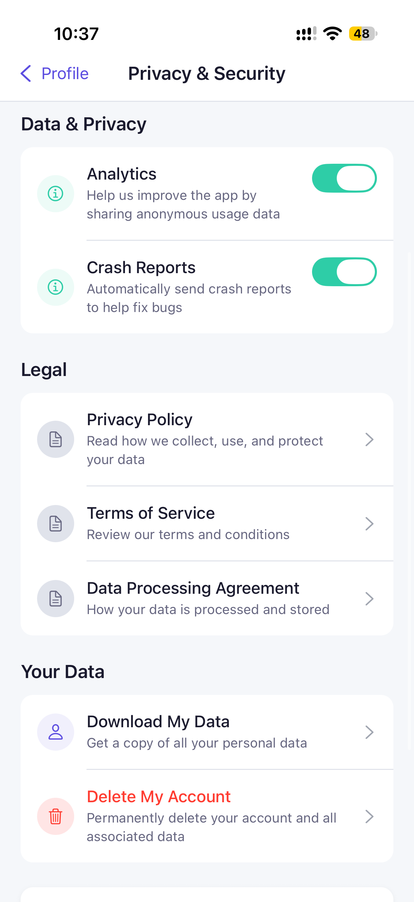</a> **Privacy and security (data rights)** — the lower portion of the same screen: analytics/crash toggles, legal links, data download, and account deletion. These actions are UI placeholders today. |

> **Note:** The two Privacy and Security screenshots are different scroll positions of the same screen. Screenshots intentionally use demo data only; never commit images containing real patient information.

---

## Architecture

### High-level architecture

~~~mermaid
flowchart LR
    subgraph Client["Client - Expo app"]
        UI["Screens and components"]
        Router["Expo Router"]
        Auth["AuthContext"]
        Services["Service layer"]
        Notifications["Notification hook"]
    end

    subgraph Supabase["Supabase"]
        SAuth["Auth"]
        DB[("Postgres + RLS")]
        Storage["Storage"]
        Realtime["Realtime"]
    end

    OS["Device notification scheduler"]

    UI --> Router
    UI --> Auth
    UI --> Services
    Auth --> SAuth
    Services --> DB
    Services --> Storage
    Services --> Realtime
    Notifications --> Services
    Notifications --> OS
~~~

### Request flow

1. **Boot:** AuthProvider restores the Supabase session, loads the user's role, and gates the (auth) and (tabs) route groups.
2. **Screen action:** a screen calls a service class (for example, CycleService.createCycle).
3. **Authorization:** the service checks ownership or shared access through RBACService.
4. **Persistence:** the service reads or writes Postgres through the Supabase client.
5. **Audit:** the service writes a best-effort audit_logs entry.
6. **Realtime:** chat and feed screens receive Postgres change events and update local state.
7. **Notifications:** the notification hook schedules local medication reminders on device.

### Service layer

| Module | Responsibility |
|---|---|
| contexts/auth-context.tsx | Session lifecycle, sign-in/up/out, role loading |
| RBACService | Patient/partner/clinician/admin checks and cycle access |
| AuditService | Best-effort audit log writes |
| CycleService | Cycle CRUD, phases, sharing, cascade delete |
| AppointmentService | Appointment CRUD and calendar queries |
| MedicationService | Medications, dosages, dose events, adherence queries |
| MoodService | Mood check-ins, symptom logs, trends, today's check-in |
| UserProfileService | Profile read/update, avatar upload/remove |
| ConversationService | Direct/group creation, conversations, invites, participants |
| MessageService | Message list/send/delete, read receipts, reply previews |
| PostService | Feed, posts, images, reactions, comments |
| RealtimeService | Postgres changes, typing broadcast, presence, invite channels |
| NotificationService | Permissions, Android channel, 7-day local reminder scheduling |

### Project structure

~~~text
.
├── app/                        # Expo Router routes (file-based navigation)
│   ├── (auth)/                 # Sign in / sign up
│   ├── (tabs)/                 # Home, Cycles, Medications, Community, Wellness, Profile
│   ├── appointments/           # Appointments by date
│   ├── community/              # Feed detail, chat, invites
│   ├── cycle/                  # Cycle create/detail/edit/appointments/share
│   ├── profile/                # Personal info, notifications, privacy
│   ├── _layout.tsx             # Auth provider, navigation stack, notifications
│   └── modal.tsx               # Expo starter placeholder
├── components/                 # Reusable UI: calendar, cards, chat, avatars, icons
├── constants/                  # Brand palette, spacing, radius, shadows, fonts
├── contexts/                   # Auth context
├── hooks/                      # Color scheme, theme, notifications
├── lib/
│   ├── services/               # Domain services (Supabase access, RBAC, audit)
│   ├── database.types.ts       # Supabase table types
│   ├── supabase.ts             # Supabase client and session persistence
│   └── uuid.ts                 # UUID validation helpers
├── assets/                     # Icons and splash assets
├── docs/screens/               # Curated product screenshots used in this README
├── scripts/                    # Expo starter reset script (destructive; see warning)
├── app.json                    # Expo configuration and plugins
├── package.json                # Dependencies and scripts
└── tsconfig.json               # Strict TypeScript + @/* path alias
~~~

---

## Technology stack

| Layer | Technology | Version | Why it is used |
|---|---|---|---|
| Runtime | Expo SDK | 58.0.19 | Fast cross-platform development, native modules, EAS builds |
| UI | React | 19.3.0 | Modern React with the React Compiler experiment enabled |
| Native runtime | React Native | 0.88.0 | One codebase for iOS, Android, and web |
| Language | TypeScript | 6.0.3 | Strict typing across screens, services, and data contracts |
| Navigation | Expo Router | 58.0.26 | File-based, typed routes and deep linking |
| Backend | Supabase | 2.90.1 client | Postgres, Auth, Storage, Realtime in one managed platform |
| Database | PostgreSQL | Supabase-managed | Relational fit for cycles, medications, sharing, and messaging |
| Auth | Supabase Auth | Supabase-managed | Email/password, session refresh, user identity |
| Storage | Supabase Storage | Supabase-managed | Avatars and community post images |
| Realtime | Supabase Realtime | Supabase-managed | Chat messages, feed updates, typing broadcast |
| Session storage | AsyncStorage | 2.2.0 | Session persistence on native (see security note) |
| Notifications | Expo Notifications | 58.1.6 | Local medication reminders and deep links |
| Media | Expo Image / Image Picker | 58.0.17 / 58.0.10 | Remote image rendering and camera/library selection |
| File access | Expo File System | 58.0.11 | Reading image files for upload |
| Date/time | React Native DateTimePicker | 9.2.1 | Native date and time selection |
| Gestures | React Native Gesture Handler | 3.3.0 | Native gesture support |
| Animation | React Native Reanimated | 4.7.1 | Typing indicator and animated UI |
| Bottom sheet | Gorhom Bottom Sheet | 5.2.8 | Avatar picker |
| Icons | Expo Symbols / Vector Icons | 58.0.4 / 15.0.3 | SF Symbols on iOS with cross-platform fallback |
| Haptics | Expo Haptics | 58.0.7 | Tactile feedback |
| Web | React Native Web | 0.21.0 | Web preview/static export |
| Tooling | ESLint + eslint-config-expo | 9.x / 58.0.4 | Linting and Expo conventions |

> @shopify/react-native-skia and victory-native are currently installed but not wired into the shipped screens. The mood trend view uses lightweight custom bars.

---

## Engineering rationale

| Decision | Rationale | Trade-off |
|---|---|---|
| **Expo + development builds** | Fastest path to a polished cross-platform MVP; native modules available through prebuild/EAS; OTA-friendly | Native debugging still requires Xcode/Android Studio; Expo Go has limits |
| **Supabase instead of Firebase** | Treatment data is relational (cycles → meds → doses → events); SQL and RLS are a better fit than document collections | Requires disciplined migrations and RLS; vendor lock-in risk |
| **Service layer between screens and Supabase** | Centralizes queries, RBAC, audit logging, and error handling; keeps screens readable | More boilerplate than direct queries |
| **Auth context only (no Redux)** | Authentication is the only truly global state; screen data is scoped and fetched on focus/refresh | No shared cache; refetching is manual today. TanStack Query is a likely next step |
| **Expo Router** | File-based navigation, typed routes, deep linking for notifications | Route structure must be learned; some route params are stringly typed |
| **Local notifications first** | Avoids sending health-adjacent data to a push provider; works without a server | No remote push, no cross-device scheduling, device-dependent reliability |
| **Strict TypeScript** | Safer refactors and clearer service contracts | Supabase types are incomplete for some tables today |
| **Custom design tokens** | Consistent purple/mint brand and card system without a heavy UI kit | Components must be maintained in-house |
| **Best-effort audit logging** | Traceability without blocking user actions | Logs are not tamper-proof and can fail silently |

### Why cycle-centric, not period-centric?

A period tracker predicts a biological cycle. A fertility treatment companion must represent a **protocol**: stimulation, monitoring, trigger, retrieval, transfer, and luteal support. Those phases determine which medication is due, which appointment matters, and what the patient is anxious about. MAIE models the treatment cycle as the primary object and keeps period-style insights secondary.

### Why community plus private tracking?

Patients often seek peer support in public social spaces because clinic portals are transactional. MAIE separates private clinical-adjacent data (cycles, medications, mood, appointments) from community data (posts, comments, chats). The product should keep that boundary explicit as moderation and privacy features mature.

---

## Data model

### Entity relationship overview

~~~mermaid
erDiagram
    USERS ||--o{ USER_ROLES : has
    USERS ||--o{ CYCLES : patient
    CYCLES ||--o{ CYCLE_PHASES : contains
    CYCLES ||--o{ APPOINTMENTS : has
    CYCLES ||--o{ MEDICATIONS : has
    MEDICATIONS ||--o{ MEDICATION_DOSAGES : has
    MEDICATION_DOSAGES ||--o{ MEDICATION_EVENTS : logs
    USERS ||--o{ MOOD_CHECKINS : records
    CYCLES ||--o{ MOOD_CHECKINS : optional
    USERS ||--o{ SYMPTOM_LOGS : records
    CYCLES ||--o{ SYMPTOM_LOGS : optional
    CYCLES ||--o{ SHARED_ACCESS : shared
    USERS ||--o{ SHARED_ACCESS : granted_to
    USERS ||--o{ AUDIT_LOGS : generates
    CONVERSATIONS ||--o{ CONVERSATION_PARTICIPANTS : includes
    USERS ||--o{ CONVERSATION_PARTICIPANTS : joins
    CONVERSATIONS ||--o{ CONVERSATION_INVITES : has
    USERS ||--o{ CONVERSATION_INVITES : receives
    CONVERSATIONS ||--o{ MESSAGES : contains
    USERS ||--o{ MESSAGES : sends
    MESSAGES ||--o| MESSAGES : reply_to_id
    CONVERSATIONS ||--o{ MESSAGE_READ_RECEIPTS : tracks
    USERS ||--o{ MESSAGE_READ_RECEIPTS : reads
    USERS ||--o{ POSTS : authors
    POSTS ||--o{ POST_COMMENTS : has
    USERS ||--o{ POST_COMMENTS : writes
    POSTS ||--o{ POST_REACTIONS : has
    USERS ||--o{ POST_REACTIONS : reacts
~~~

### Core tables

| Table | Purpose | Key relationships |
|---|---|---|
| users | Public profile mirror of auth.users | id matches the auth user |
| user_roles | Role assignment | user_id → users.id; roles: patient, partner, clinician, admin |
| cycles | Treatment cycle | patient_id → users.id |
| cycle_phases | Phase timeline (stimulation, retrieval, transfer, etc.) | cycle_id → cycles.id |
| appointments | Monitoring and procedure appointments | cycle_id → cycles.id |
| medications | Protocol medications | cycle_id → cycles.id |
| medication_dosages | Dose amount, unit, time, frequency | medication_id → medications.id |
| medication_events | Taken/missed/pending dose history | dosage_id → medication_dosages.id; confirmed_by → users.id |
| mood_checkins | Daily mood and anxiety | user_id → users.id; optional cycle_id |
| symptom_logs | Symptom and severity | user_id → users.id; optional cycle_id |
| shared_access | Partner/clinician access grant | cycle_id, granted_to, granted_by |
| audit_logs | Application audit trail | user_id → users.id |

### Community and messaging tables

| Table | Purpose | Key relationships |
|---|---|---|
| conversations | Direct or group conversation | created_by → users.id |
| conversation_participants | Membership and role | conversation_id, user_id |
| conversation_invites | Pending/accepted/declined invites | conversation_id, invited_by, invited_user_id |
| messages | Chat messages, soft delete, optional reply | conversation_id, sender_id, reply_to_id |
| message_read_receipts | Last read timestamp per user/conversation | conversation_id, user_id |
| posts | Community posts, images, pinned/milestone flags | author_id → users.id |
| post_comments | Comments and optional parent comment | post_id, author_id |
| post_reactions | One reaction type per user/post | post_id, user_id, reaction_type |

> **Schema management gap:** SQL migrations are **not versioned in this repository**. Tables were created in the Supabase project and lib/database.types.ts is partially maintained by hand. Before production, move the schema into supabase/migrations/, generate types with the Supabase CLI, and add RLS tests.

### Storage buckets

| Bucket | Path convention | Used by |
|---|---|---|
| avatars | {userId}/avatar.jpg | Profile avatar upload/remove |
| post-images | {userId}/{timestamp}.{ext} | Community post images |

Both buckets are read through public URLs in the current code. Restrict writes to the authenticated owner's path with storage policies.

### Realtime channels

| Channel | Mechanism | Used for |
|---|---|---|
| chat:{conversationId} | Postgres changes on messages | New message events |
| chat:{conversationId} | Broadcast event typing | Typing indicator |
| feed:global | Postgres changes on posts | Community feed refresh |
| invites:{userId} | Postgres changes on conversation_invites | Invite notifications (service exists; UI not wired) |

Enable Realtime replication for messages, posts, and conversation_invites in Supabase.

---

## Getting started

### Prerequisites

| Requirement | Notes |
|---|---|
| **Node.js** | 20 LTS or newer recommended (not pinned in package.json) |
| **npm** | 10+ recommended; a lockfile is present in the workspace (commit it for reproducible installs) |
| **Git** | Required to clone the repository |
| **Supabase project** | Required for auth, database, storage, and realtime |
| **Xcode** | Optional, for iOS simulator/device builds on macOS |
| **Android Studio** | Optional, for Android emulator/device builds |
| **EAS CLI** | Optional, for cloud development and store builds |
| **Expo Go** | Optional for quick UI preview; notifications are skipped |

### 1. Clone and install

~~~bash
git clone https://github.com/RobertoDure/maie.git
cd maie
npm install
~~~

The lockfile is present locally but may not be committed in every checkout. If package-lock.json is available, prefer npm ci for a reproducible install. Commit the lockfile before relying on npm ci in CI.

### 2. Configure environment variables

Create a .env file in the repository root:

~~~bash
EXPO_PUBLIC_SUPABASE_URL=https://YOUR_PROJECT_REF.supabase.co
EXPO_PUBLIC_SUPABASE_ANON_KEY=YOUR_PUBLISHABLE_ANON_KEY
~~~

- Use the publishable/anon key, never the service_role key in a client app.
- EXPO_PUBLIC_* values are embedded in the client bundle. Do not put secrets there.
- Restart Metro with a cleared cache after changing .env:

~~~bash
npx expo start -c
~~~

### 3. Provision Supabase

Follow [Supabase setup](#supabase-setup). At minimum, the app needs the tables listed in [Data model](#data-model), Auth enabled, two storage buckets, and Realtime enabled for chat/feed tables.

### 4. Start the app

~~~bash
npm start
~~~

Then choose a target in the Expo CLI:

- i — iOS simulator (macOS + Xcode)
- a — Android emulator/device
- w — web preview
- Scan the QR code with Expo Go for a quick UI preview

Or run a specific target:

~~~bash
npm run ios
npm run android
npm run web
~~~

npm run ios and npm run android use expo run:*, which prebuilds native projects. Generated ios/ and android/ folders are gitignored.

### Platform support

| Platform | Status | Notes |
|---|---|---|
| iOS | Primary | Requires macOS/Xcode or EAS; set an iOS bundle identifier before release |
| Android | Primary | Requires Android SDK or EAS; package name is currently a placeholder |
| Web | Preview | react-native-web and static export configured; native notification/camera/haptics behavior is limited |

### First-run checklist

- [ ] .env points to the correct Supabase project.
- [ ] Email auth is enabled in Supabase.
- [ ] Tables and RLS policies exist.
- [ ] avatars and post-images buckets exist.
- [ ] Realtime is enabled for messages, posts, and conversation_invites.
- [ ] A test user has a users row and a user_roles row.
- [ ] npx expo start -c runs without missing-env warnings.

---

## Supabase setup

The repository does not yet include SQL migrations. Use the Supabase dashboard or CLI to create the schema, then add versioned migrations before production.

### 1. Create a project

Create a Supabase project and copy the project URL and publishable/anon key into .env.

### 2. Enable authentication

- Enable the Email provider.
- Decide whether email confirmation is required for your environment.
- Keep anonymous sign-ins disabled unless you intentionally support guest access.
- Configure the site URL and redirect URLs for your web build.

### 3. Create the schema

Create the tables described in [Data model](#data-model). The service layer expects at least:

users, user_roles, cycles, cycle_phases, appointments, medications, medication_dosages, medication_events, mood_checkins, symptom_logs, shared_access, audit_logs, conversations, conversation_participants, conversation_invites, messages, message_read_receipts, posts, post_comments, post_reactions.

Recommended constraints:

- UUID primary keys with gen_random_uuid().
- users.id references auth.users.id.
- Foreign keys with intentional cascade behavior.
- message_read_receipts unique on (conversation_id, user_id).
- post_reactions unique on (post_id, user_id, reaction_type).
- Case-insensitive email lookup where relevant.

### 4. Enable Row-Level Security

RLS is mandatory for a health-adjacent production app. The client uses the publishable/anon key, so the database must enforce access independently of the UI.

At minimum, policies should ensure:

- A user can read/update their own users row.
- A patient can read/write their own cycles.
- A partner can read cycles granted through shared_access, and write only when access_level = 'write'.
- Mood/symptom records are visible only to their owner (and explicitly shared care contexts if designed).
- Conversation participants can read/write their conversations and messages.
- Post authors can edit/delete their own posts and comments.
- Audit logs are append-only for the application role and not broadly readable.
- Storage writes are restricted to the authenticated user's folder.

> The application-layer RBACService is a usability and defense-in-depth layer, **not** a substitute for RLS.

### 5. Create storage buckets

Create two buckets:

- avatars
- post-images

Configure public read access if the app should display images via public URLs; restrict insert/update/delete to the owner's path.

### 6. Enable Realtime

Enable Realtime replication for:

- messages
- posts
- conversation_invites

Typing indicators use broadcast and do not require table replication.

### 7. Seed roles

New users receive a patient role in the sign-up flow. Create partner, clinician, and admin roles through a trusted admin process — never from the mobile client.

### Local Supabase (optional)

A local Supabase stack is not configured yet. To add it:

~~~bash
npx supabase init
npx supabase start
~~~

Then commit supabase/ migrations and seed data. This is strongly recommended for RLS testing and onboarding.

---

## Environment variables

| Variable | Required | Used by | Notes |
|---|---|---|---|
| EXPO_PUBLIC_SUPABASE_URL | Yes | lib/supabase.ts | Supabase project URL |
| EXPO_PUBLIC_SUPABASE_ANON_KEY | Yes | lib/supabase.ts | Publishable/anon key; safe for the client only because RLS is enforced |

**Never commit** .env, service-role keys, database passwords, or real patient data. .env is already gitignored.

---

## Scripts

| Command | What it does | Notes |
|---|---|---|
| npm start | Start the Expo development server | Main development command |
| npm run ios | Prebuild and run the iOS app | Requires macOS/Xcode |
| npm run android | Prebuild and run the Android app | Requires Android SDK |
| npm run web | Start the Expo web preview | Limited native features |
| npm run lint | Run Expo ESLint | Configured |
| npx tsc --noEmit | Type-check the project | Strict mode; see known type gaps |
| npx expo start -c | Start with a cleared Metro cache | Use after env changes |
| npm run reset-project | **Destructive Expo starter script** | Do **not** run this on MAIE; it moves/deletes app/, components/, hooks/, constants/, and scripts/ |

---

## Quality and testing

### Current state

| Check | Status |
|---|---|
| ESLint | Configured (npm run lint) |
| TypeScript strict mode | Enabled |
| Supabase types | Partial; some community/chat tables are missing from lib/database.types.ts |
| Unit tests | Not configured |
| Component tests | Not configured |
| End-to-end tests | Not configured |
| CI pipeline | Not configured |
| Accessibility audit | Not performed |
| Localization | English-only |

### Recommended test strategy

1. **Unit tests** for service logic and date handling:
   - Cycle access decisions.
   - Medication schedule and dose confirmation.
   - Mood trend aggregation.
   - Chat/message mapping, including reply_to_id handling.
2. **Integration tests** against local Supabase:
   - RLS policies for patient/partner/clinician.
   - Cascade behavior for cycle deletion.
   - Unique constraints for read receipts and reactions.
3. **Component tests** with React Native Testing Library:
   - Calendar selection.
   - Medication card confirmation state.
   - Chat composer and empty states.
4. **End-to-end tests** with Maestro or Detox:
   - Sign up → create cycle → add medication → confirm dose.
   - Create post → react → comment.
   - Create chat → send message → read receipt.
5. **CI** with GitHub Actions:
   - npm ci (after committing the lockfile)
   - npm run lint
   - npx tsc --noEmit
   - unit/integration tests
   - Expo export smoke test

No test commands are documented as passing today because the suite does not exist yet.

---

## Security, privacy and compliance

### Implemented today

- Supabase Auth with session refresh.
- Auth-gated route groups.
- Application-layer RBAC for cycle read/write and medication events.
- Best-effort audit logging.
- HTTPS transport to Supabase.
- Supabase-managed encryption at rest (verify the project's plan and configuration).
- UUID validation helpers in lib/uuid.ts to prevent malformed IDs reaching Postgres.

### Required before production

- [ ] **RLS on every table**, deny by default, tested with real user roles.
- [ ] **Secure session storage.** The app currently persists the Supabase session with AsyncStorage. Migrate to expo-secure-store for health data.
- [ ] **Remove or correct the end-to-end encryption claim** in the privacy screen. The current app does **not** implement E2EE.
- [ ] **MFA** for clinician/admin accounts.
- [ ] **Data export and account deletion** flows (the UI currently has placeholders).
- [ ] **Retention and deletion policy**, including community content and audit logs.
- [ ] **PII-safe logging and monitoring**; do not log message content or health data.
- [ ] **Rate limiting and abuse controls** for auth, posts, comments, and chat.
- [ ] **Community moderation**, reporting, and crisis resources.
- [ ] **Security review and penetration test** before handling real patient data.
- [ ] **Backups and restore drills** for the production Supabase project.
- [ ] **Incident response plan** and breach notification process.

### Compliance considerations

| Regime | Applicability | Current status |
|---|---|---|
| HIPAA (US) | If MAIE is used by or for covered entities and handles PHI | Not assessed; BAA and safeguards required |
| GDPR / UK GDPR | If users are in the EU/UK | Not assessed; lawful basis, DPIA, DPA, DSAR process required |
| LGPD (Brazil) | If users are in Brazil | Not assessed |
| Medical device regulation | If diagnostic or treatment recommendations are added | Not a medical device in current form; reassess before clinical decision support |
| App store health data policies | iOS/Android release | Must be completed before submission |

> This section is an engineering checklist, not legal advice. Obtain qualified privacy and regulatory counsel before launch.

### Community safety

- Do not allow public posting of names, clinic details, or other identifiers without informed consent.
- Add report/block flows, moderation queues, and community guidelines.
- Provide crisis and mental-health resources appropriate to the user's region.
- Separate community identity from clinical identity where feasible.

### Clinical safety

- MAIE does not check drug interactions, validate dosages, or confirm clinician instructions.
- Medication names and schedules are user-entered free text/numeric values.
- Reminders are best-effort and device-dependent; they are not a guaranteed clinical alerting system.
- Any future decision-support feature requires clinical validation and likely regulatory review.

---

## Design system

| Token | Value / usage |
|---|---|
| Primary | #5B4CE0 — headers, primary actions, brand |
| Primary light/dark | #7B6EE8 / #4A3CB8 |
| Accent | #2ECDA7 — active states, highlights, secondary actions |
| Accent light/dark | #5FDCBC / #1FAE8E |
| Success / warning / error / info | #34C759 / #FF9500 / #FF3B30 / #007AFF |
| Background | #F5F7FA |
| Primary text | #1A1A2E |
| Spacing | 4, 8, 12, 16, 20, 24, 32 |
| Radius | 8, 12, 16, 20, full |
| Shadows | Small, medium, large elevation presets |

UI principles:

- Calm, low-noise surfaces with clear card hierarchy.
- One primary action per screen.
- Generous touch targets and safe-area awareness.
- Haptics for meaningful actions, not decoration.
- Use SF Symbols on iOS via expo-symbols with a Material fallback.
- Prefer plain React Native primitives over a heavy UI kit.

Accessibility gaps to address: screen-reader labels, dynamic type, contrast testing, reduced-motion support, and keyboard navigation on web.

---

## Deployment

### Build and release path

1. **Configure EAS.** No eas.json is committed yet.
   ~~~bash
   npx eas-cli build:configure
   ~~~
2. **Set production app identifiers.**
   - Android package: currently com.anonymous.maie in app.json — replace with the real reverse-DNS identifier.
   - iOS bundle identifier: add ios.bundleIdentifier in app.json.
   - Update the app name, slug, version, and store metadata.
3. **Create a production Supabase project.**
   - Apply the schema through versioned migrations.
   - Enable RLS and test every policy.
   - Configure backups, logging, and alerting.
   - Use separate projects for development, staging, and production.
4. **Build a development/production binary with EAS.**
   ~~~bash
   npx eas-cli build --platform all --profile production
   ~~~
5. **Submit to the stores.**
   ~~~bash
   npx eas-cli submit --platform ios
   npx eas-cli submit --platform android
   ~~~
6. **Web export.**
   ~~~bash
   npx expo export --platform web
   ~~~
   The web.output setting is static, so exported files can be hosted on any static host.

### Release checklist

- [ ] Production Supabase URL/key configured in the build environment.
- [ ] RLS policies tested for patient, partner, clinician, and admin.
- [ ] Session storage migrated to SecureStore.
- [ ] Privacy policy, terms, and data-processing links point to live pages.
- [ ] Data export and account deletion implemented.
- [ ] Notification permissions and Android channel verified on a development build.
- [ ] App icons, splash screens, and store screenshots finalized.
- [ ] Accessibility and localization pass completed.
- [ ] Crash reporting and analytics configured with PII redaction.
- [ ] Security review/pen test completed.
- [ ] Backups and incident response plan in place.
- [ ] Version bumped in app.json, package.json, and the in-app version string.

---

## Roadmap

### Phase 1 — Production readiness (next)

- [ ] Add supabase/migrations/ and a seed file.
- [ ] Add RLS policies and automated policy tests.
- [ ] Move session storage to expo-secure-store.
- [ ] Add unit, component, and E2E tests.
- [ ] Add GitHub Actions CI.
- [ ] Implement data export and account deletion.
- [ ] Wire notification preferences to scheduling.
- [ ] Add chat invite inbox/accept/decline UI.
- [ ] Add image messages (upload flow).
- [ ] Correct or implement the E2EE privacy claim.
- [ ] Add moderation/reporting for community content.

### Phase 2 — Clinic pilot

- [ ] Read-only clinician view with consent.
- [ ] Clinic/organization model and staff roles.
- [ ] Adherence and symptom summaries for visits.
- [ ] Appointment reminder preferences.
- [ ] Clinic-branded onboarding.
- [ ] Outcome and engagement dashboards (de-identified).

### Phase 3 — Scale

- [ ] Localization and accessibility certification.
- [ ] Push notification infrastructure with consent and preferences.
- [ ] EHR/FHIR integration exploration.
- [ ] Partner/benefits integrations.
- [ ] Advanced insights with clinical guardrails.
- [ ] SOC 2 / HIPAA / GDPR readiness program as the market requires.

---

## Known limitations

| Area | Limitation |
|---|---|
| Database | No SQL migrations are committed; schema is managed in Supabase and types are partial |
| Security | Session uses AsyncStorage; no MFA; E2EE is not implemented |
| Privacy UI | Biometric lock, analytics, crash reports, change password, download data, and delete account are UI placeholders |
| Notifications | Local medication reminders only; preference screen is not persisted; appointment/cycle/mood reminders are not implemented |
| Chat | Invite acceptance inbox missing; image messages are displayed but cannot be composed; reply UI is not exposed |
| Cycles | Phases are read-only; no phase editor; one dosage per medication in the UI |
| Sharing | Read/write supported; expiry exists in the service but not in the UI |
| Roles | Clinician/admin roles exist in the model but have no dedicated UI |
| Community | No moderation, reporting, blocking, or content guidelines enforcement |
| Platform | Web has limited native features; no push notifications; no offline mode |
| Quality | No automated tests, CI, accessibility audit, or localization |
| Release | No EAS project, store listing, iOS bundle ID, or production app package name |
| Template leftovers | app/modal.tsx and scripts/reset-project.js are Expo starter artifacts |

---

## Contributing

This repository is currently a private MVP. If you have access and want to contribute:

1. **Branch from main.**
   - feat/short-description
   - fix/short-description
   - docs/short-description
2. **Use clear commits.** Conventional commits are preferred:
   - feat: add appointment reminder preference
   - fix: handle undefined reply ids
   - docs: document Supabase RLS requirements
3. **Keep the service layer consistent.**
   - Put Supabase access in lib/services/.
   - Enforce RBAC and audit logging at the service boundary.
   - Validate UUIDs with lib/uuid.ts before passing them to filters.
4. **Respect the design system.**
   - Use constants/theme.ts tokens.
   - Prefer reusable components over one-off styles.
5. **Before opening a pull request:**
   - Run npm run lint.
   - Run npx tsc --noEmit and report any pre-existing gaps.
   - Add or update tests when the suite exists.
   - Include screenshots for UI changes.
   - Update this README and lib/database.types.ts when routes, tables, or env vars change.
6. **Never commit:**
   - .env or secrets.
   - Real patient data or screenshots containing identifiers.
   - Service-role keys.
   - Generated ios/, android/, dist/, or .expo/ artifacts.

For security issues, do **not** open a public issue. Use GitHub's private security advisory flow instead.

---

## License

No LICENSE file is currently included, and package.json is marked "private": true. Treat the code as **proprietary and all rights reserved** until a license is explicitly selected.

Before distributing, accepting external contributions, or open-sourcing any part of MAIE, add a LICENSE file and complete the necessary legal review.

---

## Support

- **Bugs and feature requests:** [GitHub Issues](https://github.com/RobertoDure/maie/issues)
- **Security reports:** use the repository's private security advisory flow
- **Maintainer:** [@RobertoDure](https://github.com/RobertoDure)

There is no hosted demo or production support SLA at this stage.

---

## FAQ

**Is MAIE a medical device?**
No. It is a tracking and coordination tool. It does not diagnose, treat, or recommend a clinical protocol.

**Does MAIE replace my clinic's instructions?**
No. Always follow your clinic's medication and appointment instructions. If they conflict with the app, the clinic wins.

**Is my data end-to-end encrypted?**
No. The privacy screen currently makes an E2EE claim that is not implemented. Data is transmitted over HTTPS and stored in Supabase, but E2EE is a roadmap/security item. Do not rely on the app for E2EE today.

**Does it work offline?**
No. The app requires network access for authentication, data, and realtime features.

**Can I use it on the web?**
Yes, for preview and basic flows. Native notifications, camera, haptics, and some pickers are limited on web.

**Can clinics use it today?**
Not as a clinic product. The role model and sharing layer exist, but there is no clinician dashboard, organization model, or admin console yet.

**Are notifications reliable enough to replace an alarm?**
No. Local reminders are best-effort and device-dependent. Use your clinic's instructions and your own backup alarms for time-critical doses.

**Is there a hosted demo?**
No. Run the app locally against a Supabase project.

---

## Acknowledgements

- [Expo](https://expo.dev/) and the Expo Router team for the cross-platform foundation.
- [React Native](https://reactnative.dev/) and the open-source ecosystem.
- [Supabase](https://supabase.com/) for Postgres, Auth, Storage, and Realtime.
- The maintainers of Reanimated, Gesture Handler, Bottom Sheet, DateTimePicker, and the other libraries in package.json.
- The fertility community members and clinicians whose lived experience should shape the product — with consent, privacy, and respect.

---

## Medical disclaimer

**MAIE is not a medical device and does not provide medical advice, diagnosis, or treatment.** It is a personal tracking and coordination tool. Medication schedules, appointment details, mood scores, symptom logs, and reminders are user-entered or user-confirmed and may be incomplete or inaccurate.

Always follow the instructions of your qualified healthcare provider. Do not delay or disregard clinical advice because of something you read or recorded in this app. In an emergency, contact your local emergency services immediately.

---

  Built with care for people navigating fertility treatment.

